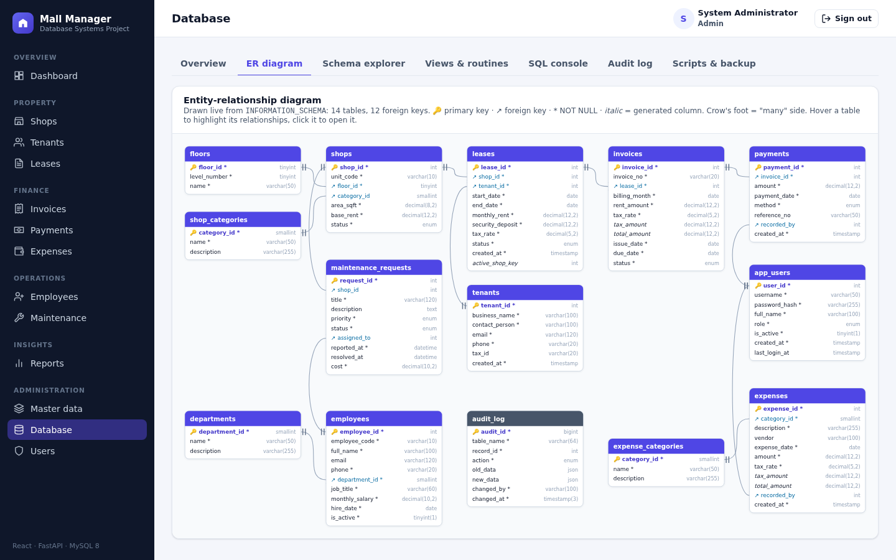
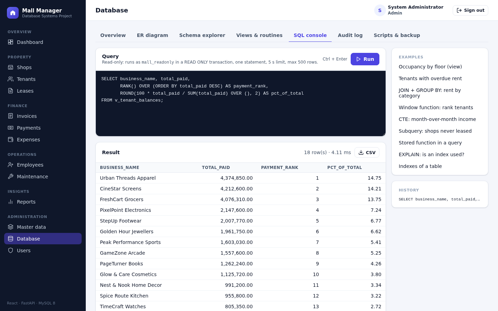

# Mall Management System

A full-stack **database systems (DBMS) course project**: a web application for
running a shopping mall, built around a carefully designed **MySQL 8**
database.

* **Database**: normalised schema (BCNF) with primary / foreign / unique keys,
  CHECK constraints, generated columns, 13 views, stored functions and
  procedures with transactions, 25 triggers, a scheduled event, roles and
  least-privilege accounts, and an audit trail stored as JSON.
* **Backend**: Python **FastAPI** REST API (PyMySQL, JWT login, role-based
  access). Business rules live in the database; the API turns MySQL errors
  into readable messages.
* **Frontend**: **React** (Vite) single-page app with dashboards and charts
  (Recharts), CRUD screens, reports with CSV export, and a database explorer
  (live ER diagram, schema browser, SQL console, audit log, backup).

| Dashboard | Live ER diagram |
|---|---|
|  |  |
| **Reports with SQL, chart and CSV export** | **Read-only SQL console** |
|  |  |

---

## Features

| Area | What you can do | Database features behind it |
|---|---|---|
| **Shops** | Units per floor and category, area, base rent, status | FKs, CHECK, status kept in sync by triggers |
| **Tenants** | Businesses, contacts, balance and overdue amount, account statement | `v_tenant_balances`, `sp_tenant_statement` (window function) |
| **Leases** | Create, edit, terminate early, run the expiry job | one-active-lease rule (trigger + unique generated column), `sp_terminate_lease`, `sp_expire_leases`, nightly `EVENT` |
| **Invoices** | Generate monthly rent bills with tax, void unpaid bills | `sp_generate_invoices` (set-based INSERT … SELECT), generated tax / total columns |
| **Payments** | Record full or partial payments, reverse (admin) | `sp_record_payment` (transaction, `SELECT … FOR UPDATE`), status triggers, immutability |
| **Expenses** | Operating costs by category with tax | generated columns, no-future-date trigger |
| **Employees** | Staff by department, salary, active flag | audit of salary / department changes |
| **Maintenance** | Tickets for shops and common areas, priority, assignee, cost | `resolved_at` set by trigger, `ON DELETE SET NULL` |
| **Reports** | 12 view-based reports + 2 procedure reports, charts, CSV export | views, CTEs (recursive), window functions, UNION ALL |
| **Database** | ER diagram, schema explorer, object source, SQL console, audit log, backup / restore | `INFORMATION_SCHEMA`, `SQL SECURITY DEFINER` procedure, read-only account, JSON |
| **Users** | Admin / manager / staff accounts | bcrypt hashes, role checks in API and UI |

## Project structure

```
.
├── database/                SQL scripts, run in name order
│   ├── 01_schema.sql        tables, keys, constraints, indexes
│   ├── 02_views.sql         13 reporting views
│   ├── 03_routines.sql      functions, procedures (transactions), event
│   ├── 04_triggers.sql      validation, derived status, audit trail
│   ├── 05_seed.sql          sample data (dates relative to today)
│   ├── 06_security.sql      roles and application accounts
│   └── examples/            sample queries and a transactions demo
├── backend/                 FastAPI application
│   ├── app/                 config, database helpers, security, routers
│   └── tests/               integration tests (pytest)
├── frontend/                React + Vite application
│   └── src/                 pages, components, API client, styles
├── scripts/                 data dictionary and report (.docx) generators
├── docs/                    ER diagram, data dictionary, normalisation, API, project report
└── manage.py                one helper for setup, running, backup / restore and tests
```

## Getting started

Everything runs directly on your machine; no Docker or other container tool is
needed. Install:

- **MySQL 8.0.16+** (8.4 LTS recommended), server and command-line client
- **Python 3.10+**
- **Node.js 18+** (includes npm)

`manage.py` only uses the Python standard library and works the same on
Windows, macOS and Linux (use `python3` instead of `python` where needed).

### 1. Create the database

```bash
python manage.py setup-db          # asks for the MySQL root password
```

This runs `database/01_schema.sql` … `06_security.sql` in order. If `mysql` is
not on your `PATH`, point to its folder first, e.g.
`set MYSQL_BIN_DIR=C:\Program Files\MySQL\MySQL Server 8.4\bin` (Windows) or
`export MYSQL_BIN_DIR=/usr/local/mysql/bin` (macOS). Without the helper you can
also run the files yourself: `mysql -u root -p < database/01_schema.sql`, then
02 … 06.

Two MySQL accounts are created for the app:

| Account | Used for | Privileges |
|---|---|---|
| `mall_app` / `MallApp#2024` | the API | SELECT, EXECUTE, and only the INSERT / UPDATE / DELETE each table needs (e.g. payments cannot be updated, invoices cannot be deleted, audit log is read-only) |
| `mall_readonly` / `MallRead#2024` | SQL console, table browser | SELECT on tables and views (not on password hashes) |

> Change these passwords in `database/06_security.sql` and `backend/.env` for anything other than local use.

### 2. Start the app

```bash
python manage.py start
```

The first run creates `backend/.venv`, installs the Python packages, copies
`backend/.env.example` to `backend/.env`, runs `npm install` and builds the
frontend; later runs start straight away. Open <http://localhost:8000>
(API documentation at <http://localhost:8000/docs>). Use
`python manage.py start --host 0.0.0.0` to reach it from other devices on your
network.

### While developing

```bash
python manage.py dev               # API with auto-reload + Vite on http://localhost:5173
```

The Vite dev server reloads the page on every change and proxies `/api` to the
API on port 8000.

### Demo accounts

| Username | Password | Role |
|---|---|---|
| `admin` | `Admin@123` | everything, including users, payment reversal and backups |
| `manager` | `Manager@123` | all business data, reports, database explorer |
| `staff` | `Staff@123` | read-only, plus maintenance tickets |

## Backup and restore

| Method | Command | Contains |
|---|---|---|
| Full logical backup | `python manage.py backup` → `backups/mall_db_<timestamp>.sql.gz` | schema, data, views, routines, triggers, events (`mysqldump --single-transaction --routines --triggers --events`) |
| Restore | `python manage.py restore backups/mall_db_<timestamp>.sql.gz` | re-creates the database, then re-applies accounts from `06_security.sql` |
| Data-only backup from the app | Database → Scripts & backup → *Download data backup* (admin) | INSERT statements in foreign-key order; load into a schema created with `python manage.py setup-db --no-seed` |

`setup-db`, `backup` and `restore` connect as an administrative MySQL account
taken from the environment variables `MYSQL_HOST`, `MYSQL_PORT`, `MYSQL_USER`
and `MYSQL_PWD` (defaults: `127.0.0.1`, `3306`, `root`, prompt).

## Tests

```bash
python manage.py test              # extra arguments go to pytest, e.g. -k invoices
```

The integration tests run against the real database and cover login, roles,
validation, CHECK / FK / trigger errors, the full lease → invoice → payment →
termination cycle, reports, the read-only SQL console and the admin tools.
They add their own test records; run `python manage.py setup-db` afterwards to
get back to the clean sample data.

## Learning material

| File | Contents |
|---|---|
| [docs/PROJECT_REPORT.md](docs/PROJECT_REPORT.md) | Project report: problem statement, requirements, design, implementation, testing |
| [docs/ER_DIAGRAM.md](docs/ER_DIAGRAM.md) | ER diagram (Mermaid), cardinalities, business rules |
| [docs/NORMALIZATION.md](docs/NORMALIZATION.md) | From a flat register to BCNF, step by step; controlled redundancy |
| [docs/DATA_DICTIONARY.md](docs/DATA_DICTIONARY.md) | Every table and column (generated from the database) |
| [docs/API.md](docs/API.md) | REST endpoints and error mapping |
| [database/examples/sample_queries.sql](database/examples/sample_queries.sql) | Joins, GROUP BY / HAVING, subqueries, set operations, CTEs, window functions, views, functions, EXPLAIN |
| [database/examples/transactions_demo.sql](database/examples/transactions_demo.sql) | COMMIT / ROLLBACK / SAVEPOINT, procedures as transactions, every integrity rule failing on purpose, locking |

## Notes

* All names, businesses, phone numbers and e-mail addresses in the sample data
  are fictional (`.example` domains). Amounts are plain numbers with no
  currency; the tax rate (default 18 %) is configurable per lease and expense.
* Sample dates are relative to the day the seed script runs, so the dashboard
  always shows the last 12 months.

## License

Released under the MIT License for educational use.
