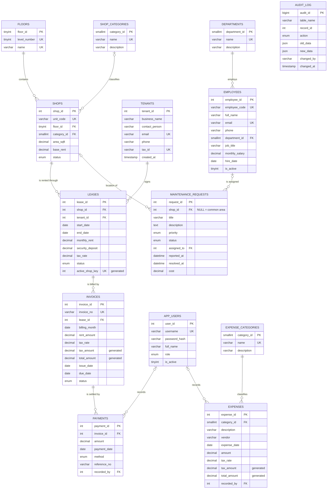

# Entity-relationship model

The diagram below renders on GitHub and in any Mermaid-aware Markdown viewer.
The web app also draws a **live** ER diagram straight from `INFORMATION_SCHEMA`
(Database → ER diagram).

`AUDIT_LOG` has no foreign keys on purpose: it must keep history even after
the referenced row is deleted.

## Entities and relationships

| Relationship | Cardinality | Participation | Delete rule |
|---|---|---|---|
| Floor contains shops | 1 : N | every shop is on exactly one floor | RESTRICT |
| Category classifies shops | 1 : N | a shop may be uncategorised | SET NULL |
| Shop – Tenant through **Lease** | M : N (resolved by `leases`) | a shop may be vacant; a tenant may lease several shops | RESTRICT |
| Lease is billed by invoices | 1 : N | one invoice per lease per month (`UNIQUE(lease_id, billing_month)`) | RESTRICT |
| Invoice is settled by payments | 1 : N | partial payments allowed | RESTRICT |
| Department employs employees | 1 : N | every employee has a department | RESTRICT |
| Expense category classifies expenses | 1 : N | mandatory | RESTRICT |
| Shop is location of maintenance requests | 1 : N | NULL = common area | SET NULL |
| Employee is assigned maintenance requests | 1 : N | optional | SET NULL |
| App user records payments / expenses | 1 : N | optional | SET NULL |

### Business rules that keys alone cannot express

| Rule | Enforced by |
|---|---|
| A shop has at most one **active** lease | `trg_leases_before_insert/update` **and** `UNIQUE(active_shop_key)` on a generated column |
| Leases can only be created for a vacant (not under-maintenance) shop | `trg_leases_before_insert` |
| Shop status follows its leases (occupied / vacant) | `trg_leases_after_insert/update/delete` |
| Invoice status follows its payments (unpaid → partially paid → paid) | `trg_payments_after_insert/delete` |
| A payment cannot exceed the balance, be dated in the future or target a void invoice | `trg_payments_before_insert` and `sp_record_payment` |
| Payments are immutable (corrections are reversals) | `trg_payments_before_update` + no UPDATE privilege for the app account |
| Expenses cannot be dated in the future | `trg_expenses_before_insert/update` (CHECK cannot use `CURDATE()`) |
| `resolved_at` is set when a ticket is resolved / closed | `trg_maintenance_before_update` |
| Every change to key tables is recorded | `AFTER` triggers writing JSON row images to `audit_log` |
