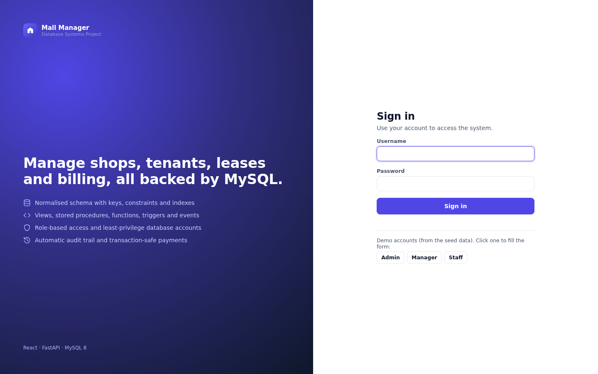
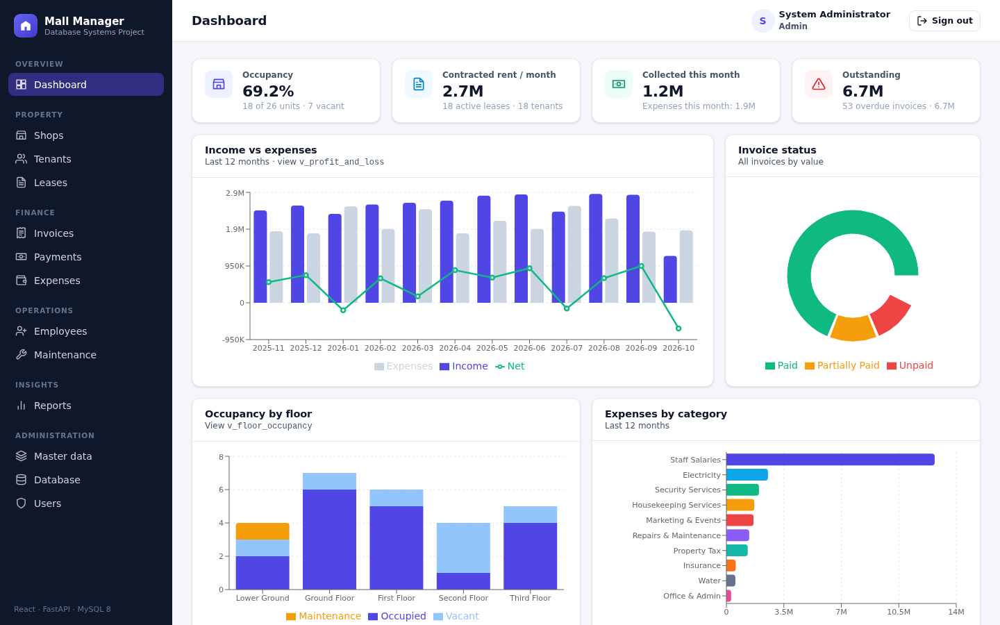
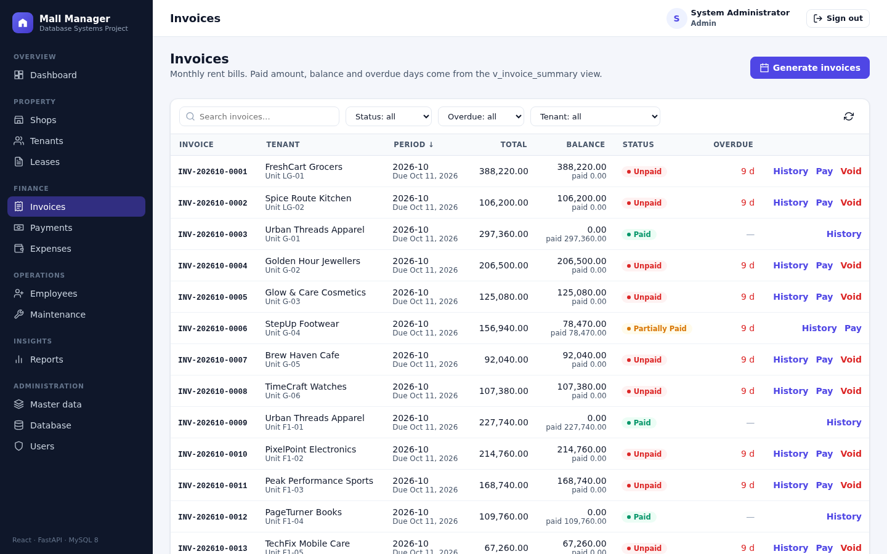
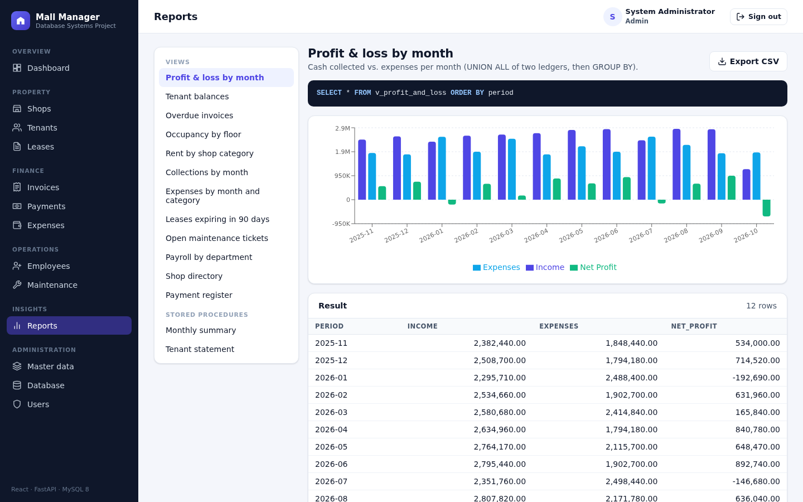
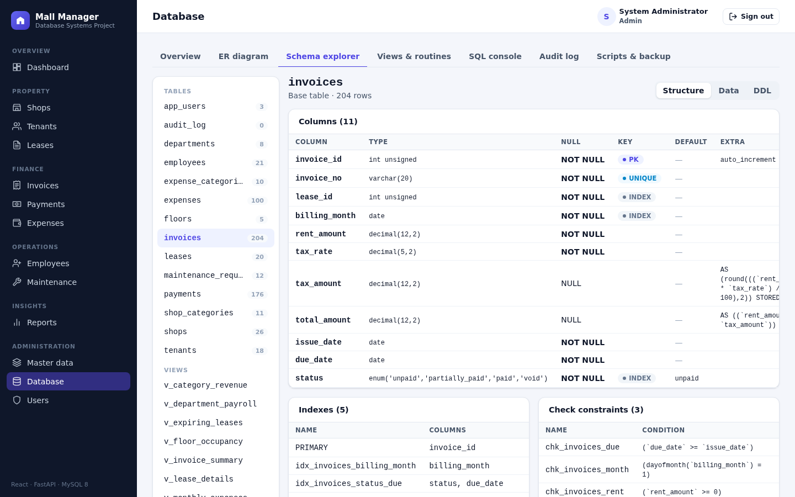
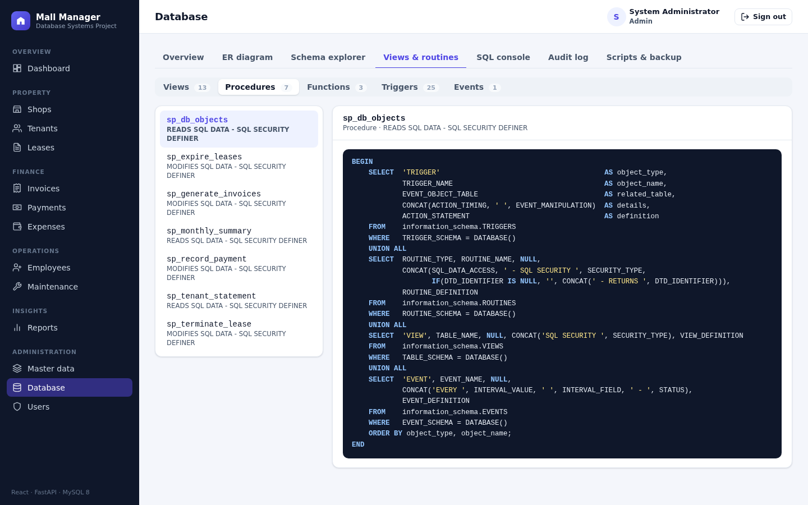

# Mall Management System
## Project report: Database Management Systems

---

## Abstract

The Mall Management System is a web application for a shopping-mall
management office. It keeps track of the mall's shop units, the tenants that
rent them, lease agreements, monthly rent invoices with tax, payments,
operating expenses, staff and maintenance work, and turns this data into
reports and charts.

The project focuses on the **database layer**. The data model is normalised to
Boyce-Codd normal form, and the important business rules are enforced by the
DBMS itself through keys, CHECK constraints, triggers, stored procedures with
transactions, views, a scheduled event and least-privilege accounts. Even a
client that bypassed the application could not corrupt the data. A FastAPI
backend exposes the database through a REST API. A React frontend provides
the user interface, including a database explorer that shows the schema, the
ER diagram, the source code of every database object, a read-only SQL console
and the audit trail.

---

## 1. Introduction

### 1.1 Problem statement
A mall office typically manages its rental business with spreadsheets: a sheet
of shops, a sheet of tenants, a rent register and a cash book. This leads to
duplicated data (a tenant's phone number in every row of the rent register),
inconsistencies (a shop marked vacant although a lease is active), lost
history, manual tax calculations, and no reliable way to answer questions such
as *"which tenants are overdue and by how much?"* or *"what was our net cash
flow each month?"*.

### 1.2 Objectives
1. Design a relational database that stores mall operations without
   redundancy or update anomalies (3NF / BCNF).
2. Enforce business rules inside the DBMS: domain constraints, referential
   integrity, derived values and multi-row rules.
3. Implement transactional operations (invoice generation, payment recording,
   lease termination) as stored procedures.
4. Provide reports and data analysis through views, CTEs and window functions.
5. Secure the database with roles, least-privilege accounts and an audit trail.
6. Build a usable full-stack application (REST API + web UI) on top of it.
7. Support backup, restore and data export (CSV).

### 1.3 Scope
**In scope:** floors and shop categories; shops; tenants; leases; monthly
invoices with tax; partial payments; operating expenses with tax; departments
and employees; maintenance requests; reports and dashboards; CSV export; user
accounts with roles; database administration tools; backup and restore.

**Out of scope:** online payment gateways, payroll processing, and
multi-property support.

---

## 2. Requirements

### 2.1 Functional requirements
| ID | Requirement |
|---|---|
| F1 | Users log in; access depends on role (admin, manager, staff). |
| F2 | Maintain floors, shop categories, departments and expense categories. |
| F3 | Maintain shops with floor, category, area, base rent and status. |
| F4 | Maintain tenants and their contact details. |
| F5 | Create leases for vacant shops; terminate leases early; expire leases automatically after their end date. |
| F6 | Generate monthly rent invoices for all active leases, with tax and due date, without creating duplicates. |
| F7 | Record full or partial payments; invoice status updates automatically; over-payment is rejected. |
| F8 | Record operating expenses by category, with tax. |
| F9 | Maintain employees by department; log and track maintenance requests. |
| F10 | Dashboard with KPIs and charts; 14 reports with charts and CSV export; tenant account statements. |
| F11 | Explore the database: ER diagram, schema, constraints, views, routines, triggers, events, read-only SQL console, audit log. |
| F12 | Back up and restore the database. |

### 2.2 Non-functional requirements
| Area | Requirement |
|---|---|
| Integrity | Business rules are enforced in the database, not only in the UI. |
| Consistency | Multi-step operations are atomic (transactions). |
| Security | Passwords stored as bcrypt hashes; JWT authentication; DB accounts with minimal privileges; SQL console cannot modify data. |
| Auditability | Changes to key tables are recorded automatically with old/new values. |
| Usability | Responsive web UI with search, sort, filters, pagination and readable error messages. |
| Portability | Runs on Windows, macOS and Linux with only MySQL 8, Python and Node.js installed; one cross-platform helper (`manage.py`) sets everything up. |

---

## 3. System design

### 3.1 Architecture

```
 Browser (React SPA)
        │  HTTPS / JSON (JWT bearer token)
        ▼
 FastAPI backend ── routers: auth, resources, billing, reports, admin
        │  PyMySQL
        ├── mall_app       (DML on business tables, EXECUTE on procedures)
        └── mall_readonly  (SELECT only: SQL console, table browser)
        ▼
 MySQL 8 ── mall_db: tables, views, functions, procedures, triggers, event
```

The backend contains very little business logic: validation of input
types (Pydantic), authentication and authorisation, and calls to views and
stored procedures. Rules such as "one active lease per shop" or "no
over-payment" live in the database, and their error messages are passed
through to the user.

### 3.2 Technology
| Layer | Technology |
|---|---|
| Database | MySQL 8.4 (InnoDB, utf8mb4) |
| Backend | Python 3, FastAPI, PyMySQL, Pydantic, PyJWT, bcrypt |
| Frontend | React 19, React Router, Recharts, Vite |
| Testing | pytest + FastAPI TestClient (integration tests against MySQL) |
| Tooling | `manage.py` (Python standard library): database setup, start, backup / restore, tests |

### 3.3 Conceptual design (ER model)
The main entities are **Floor, ShopCategory, Shop, Tenant, Lease, Invoice,
Payment, Department, Employee, ExpenseCategory, Expense, MaintenanceRequest,
AppUser** and **AuditLog**.

The many-to-many relationship between Shop and Tenant is resolved by the
**Lease** entity. A lease has its own attributes (dates, rent, deposit, tax
rate, status) and its own history: a shop can be leased to different tenants
over time, and a tenant can lease several shops. Each lease produces one
invoice per month; each invoice can be settled by several payments.

The full diagram with cardinalities is in [ER_DIAGRAM.md](ER_DIAGRAM.md). The
running application draws it live from the data dictionary (Database → ER
diagram).

### 3.4 Logical design and normalisation
The schema was derived from a flat "rent register" by removing repeating
groups (1NF), partial dependencies on the composite key {unit, month} (2NF)
and transitive dependencies such as tenant → phone (3NF). Every determinant
in the final schema is a candidate key (BCNF). The derivation and the list of
deliberate, controlled redundancies (invoice amount snapshot, generated
columns, status columns kept by triggers) are in
[NORMALIZATION.md](NORMALIZATION.md).

### 3.5 Physical design
| Element | Count | Examples |
|---|---|---|
| Tables | 14 | `shops`, `leases`, `invoices`, `payments`, `audit_log` |
| Foreign keys | 12 | `RESTRICT` for financial data, `SET NULL` for optional links |
| CHECK constraints | 22 | `area_sqft > 0`, `end_date > start_date`, `tax_rate BETWEEN 0 AND 100`, e-mail / phone format via `REGEXP` |
| Unique keys | 14 | natural keys, `UNIQUE(lease_id, billing_month)` |
| Indexes | 49 | FK columns, status / date columns used by reports |
| Generated columns | 5 | `tax_amount`, `total_amount` (STORED), `active_shop_key` (VIRTUAL) |
| Views | 13 | `v_invoice_summary`, `v_tenant_balances`, `v_profit_and_loss` |
| Functions | 3 | `fn_invoice_paid`, `fn_invoice_balance`, `fn_invoice_status` |
| Procedures | 7 | `sp_generate_invoices`, `sp_record_payment`, `sp_terminate_lease`, `sp_monthly_summary` |
| Triggers | 25 | validation, derived status, audit |
| Events | 1 | `ev_daily_expire_leases` |

Monetary values use `DECIMAL(12,2)`, never floating point. Every table has a
surrogate `AUTO_INCREMENT` key, and the natural key is kept as a `UNIQUE`
constraint. The column-level details are in [DATA_DICTIONARY.md](DATA_DICTIONARY.md).

---

## 4. Implementation

### 4.1 Integrity rules
| Level | Mechanism | Example |
|---|---|---|
| Domain | data types, `ENUM`, `NOT NULL`, `CHECK` | priority ∈ {low, medium, high, critical} |
| Entity | `PRIMARY KEY`, `UNIQUE` | unit code, invoice number, username |
| Referential | `FOREIGN KEY … ON DELETE RESTRICT / SET NULL ON UPDATE CASCADE` | a floor with shops cannot be deleted |
| Multi-row | `BEFORE` triggers with `SIGNAL` | a shop can have only one active lease |
| Temporal | triggers (CHECK cannot use `CURDATE()`) | no future payments or expenses |
| Derived data | generated columns, `AFTER` triggers | invoice total; shop and invoice status |

### 4.2 Transactions and concurrency
`sp_record_payment` shows a classic transaction:

1. `START TRANSACTION`
2. `SELECT … FROM invoices WHERE invoice_id = ? FOR UPDATE` locks the invoice
   row, so two clerks cannot both pay the last balance at the same time.
3. Check the status and remaining balance; `SIGNAL` an error if the payment
   is not allowed.
4. `INSERT INTO payments`. The `AFTER INSERT` trigger recalculates the
   invoice status inside the same transaction.
5. `COMMIT`. On any SQL error an `EXIT HANDLER` runs `ROLLBACK` and
   `RESIGNAL`s the error.

`sp_generate_invoices` is a set-based, idempotent batch: one
`INSERT … SELECT` for all leases in force during the month. `NOT EXISTS` and
the `UNIQUE(lease_id, billing_month)` key make it safe to run repeatedly.
`sp_terminate_lease` ends a lease and voids its future unpaid invoices
atomically. `database/examples/transactions_demo.sql` demonstrates COMMIT,
ROLLBACK, SAVEPOINT, row locking, and the fact that MySQL has no nested
transactions: a procedure's `START TRANSACTION` commits the caller's open
transaction.

### 4.3 Reporting and analysis
* **Views** encapsulate joins and aggregations: occupancy per floor, rent per
  category, tenant balances with overdue amounts, monthly income and expenses,
  profit and loss, expiring leases, open maintenance, payroll per department.
* **`sp_monthly_summary(year)`** uses a recursive CTE to generate all twelve
  months (including months without data). Correlated subqueries compute the
  invoiced amount, collections and expenses, and `SUM() OVER (ORDER BY …)`
  gives the cumulative net cash flow.
* **`sp_tenant_statement(tenant)`** merges invoices and payments with
  `UNION ALL` and computes a running balance with a window function.
* The UI shows each report's SQL next to its chart and table, and every report
  can be exported as CSV.

### 4.4 Security
* **Application level**: bcrypt password hashes; JWT tokens; three roles
  checked by the API on every request and reflected in the UI.
* **Database level**: two roles, `mall_app_role` and `mall_readonly_role`,
  following the principle of least privilege. The application account
  cannot `UPDATE` payments, `DELETE` invoices, or modify the audit log. The
  read-only account cannot read password hashes (column-level privilege).
* **Controlled elevation**: `sp_db_objects()` is a `SQL SECURITY DEFINER`
  procedure. It lets the application list the source code of triggers and
  routines without receiving broad global privileges.
* **SQL console**: allows only one `SELECT / WITH / SHOW / DESCRIBE / EXPLAIN`
  statement, runs it as `mall_readonly` in a `READ ONLY` transaction with
  `MAX_EXECUTION_TIME`, and caps the result at 500 rows (defence in depth).
* **Audit trail**: `AFTER` triggers write the old and new row images as `JSON`
  together with the application user, which the API passes in the session
  variable `@app_user`.

### 4.5 Backend
| Module | Responsibility |
|---|---|
| `config.py` | settings from environment / `.env` |
| `database.py` | connections (app and read-only), query helpers, procedure calls with OUT parameters |
| `security.py` | password hashing, JWT, current user, role checks, `SET @app_user` |
| `errors.py` | maps MySQL error codes to HTTP responses |
| `crud.py` | generic list / get / create / update / delete with search, sort, filters, pagination |
| `routers/` | `auth`, `resources`, `billing`, `reports`, `admin` |

### 4.6 Frontend
| Screen | Purpose |
|---|---|
| Login | sign in; demo account buttons |
| Dashboard | KPIs, income vs expenses, invoice status, occupancy per floor, expenses per category, top debtors, expiring leases, recent payments, open tickets |
| Shops, Tenants, Leases, Invoices, Payments, Expenses, Employees, Maintenance | searchable, sortable, filterable lists with create / edit / delete forms and the domain actions (generate invoices, record payment, terminate lease, tenant statement …) |
| Reports | report catalogue with SQL, chart, result table and CSV export |
| Master data | floors, shop categories, departments, expense categories |
| Database | overview, live ER diagram, schema explorer (structure, data, DDL), views & routines, SQL console, audit log, scripts & backup |
| Users, My account | user administration; change password |

| | |
|---|---|
|  |  |
|  |  |
|  |  |

---

## 5. Testing

Integration tests (`backend/tests/test_api.py`) run against a real MySQL
database:

| # | Test | Expected result |
|---|---|---|
| 1 | Health check | API and database reachable |
| 2 | Login with a wrong password | 401 |
| 3 | Request without a token | 401 |
| 4 | Current user | correct role returned |
| 5 | List with search, sort, pagination | correct subset and total |
| 6 | Staff tries to create a shop | 403 |
| 7 | Invalid values / CHECK constraint | 422 with a readable message |
| 8 | Delete a floor that still has shops | 409 (FK RESTRICT) |
| 9 | Full cycle: tenant → shop → lease → shop occupied → second lease rejected → invoices generated (idempotent, tax computed) → partial payment → over-payment rejected → full payment → voiding a paid invoice rejected → statement balance 0 → termination → shop vacant → audit trail shows the application user | every step behaves as specified |
| 10 | Reports, CSV export, monthly summary, tenant statement | data returned, CSV header present |
| 11 | SQL console with `DELETE`, multiple statements | rejected; SELECT works |
| 12 | Admin tools: overview, schema, objects, audit, backup, ER metadata; staff denied | correct data; 403 for staff |
| 13 | User management | create, update, reset password, delete |

In addition, `database/examples/transactions_demo.sql` lists every integrity
rule with a statement that violates it and the error MySQL returns (1062,
1451, 1452, 3819, 1644, 1142).

---

## 6. Results
The finished system meets all functional requirements F1–F12. The sample
data (26 shops on 5 floors, 18 tenants, 20 leases, 204 invoices, 176 payments,
100 expenses, 21 employees, 12 maintenance requests) produces a populated
dashboard for the last twelve months. The seed dates are relative to the day
the database is created, so the data always looks current.

## 7. Limitations and future work
* Single property only; a `properties` table could make the system multi-site.
* Rent escalation clauses and service charges could be modelled as separate
  lease terms.
* Payments are entered manually; integrating a payment provider would need an
  idempotency key per transaction.
* Reports could be materialised (summary tables refreshed by events) if the
  data volume grew large.
* Point-in-time recovery would require binary-log based backups in addition
  to logical dumps.

## 8. Conclusion
The project shows how a relational DBMS can be the guardian of data quality
and not just storage. Normalisation removes anomalies. Constraints and
triggers make invalid states impossible. Stored procedures turn business
operations into atomic transactions. Views and analytical SQL answer
management questions directly. Roles and an audit trail keep the data secure
and accountable. The web application on top stays simple because the database
does the heavy lifting.

## References
1. MySQL 8.4 Reference Manual, Oracle Corporation. <https://dev.mysql.com/doc/refman/8.4/en/>
2. A. Silberschatz, H. F. Korth, S. Sudarshan, *Database System Concepts*, McGraw-Hill.
3. R. Elmasri, S. B. Navathe, *Fundamentals of Database Systems*, Pearson.
4. FastAPI documentation. <https://fastapi.tiangolo.com/>
5. React documentation. <https://react.dev/>
