# Mall Management System

**Database Systems  ·  Course Project Report**

*A full-stack relational database application for running a shopping mall: shops, tenants, leases, rent billing with tax, payments, staff, maintenance and expenses*

<i>The finished application: dashboard with live figures computed by database views</i>

| Field | Details |
|---|---|
| **Student name** | &nbsp; |
| **Register number** | &nbsp; |
| **Course / slot** | &nbsp; |
| **Faculty** | &nbsp; |
| **Date of submission** | &nbsp; |

MySQL 8.4  ·  Python FastAPI  ·  React  ·  runs locally with one command (no Docker)

---

## Contents

1. [Introduction](#1-introduction)
2. [Database concepts applied](#2-database-concepts-applied)
3. [Technical architecture](#3-technical-architecture)
4. [Conceptual design: the ER model](#4-conceptual-design-the-er-model)
5. [Relational design and normalisation](#5-relational-design-and-normalisation)
6. [Physical design and query processing](#6-physical-design-and-query-processing)
7. [Business workflow and automation](#7-business-workflow-and-automation)
8. [Transactions, concurrency and recovery](#8-transactions-concurrency-and-recovery)
9. [Results, testing and outlook](#9-results-testing-and-outlook)

---

## 1. Introduction

A shopping mall is a small business ecosystem. Dozens of **shop units** spread over several floors are let to **tenants** under **leases**. Every month each lease produces a **rent invoice** with tax, which the tenant may pay in one go or in parts. At the same time the mall employs **staff**, handles **maintenance** requests and pays **operating expenses**. Kept in registers or spreadsheets, this information quickly goes wrong: tenant details are copied in many places, bills contain arithmetic slips, two clerks can accept the same payment, and nobody can say who changed a figure or when.

This project replaces that with a **relational database** at the centre of a complete web application. The database does more than store data. Its own constraints, triggers, stored procedures and transactions enforce the business rules, so wrong data is rejected however it arrives.

### 1.1 Objectives

- Design a normalised (3NF / BCNF) relational schema from an Entity-Relationship model.
- Enforce integrity with keys, CHECK constraints, foreign keys and triggers.
- Handle money safely under concurrent use with ACID transactions and row locking.
- Offer a web interface with role-based access, reports, charts and CSV export.
- Support auditing, backup and restore, and explore the database from the browser.

| 14 | 13 | 10 | 25 | 22 | 49 | 3 |
|---|---|---|---|---|---|---|
| tables | views | functions & procedures | triggers | CHECK constraints | indexes | user roles |

### 1.2 Scope

The application covers **shops and categories**, **tenants**, **leases**, monthly **invoices with tax**, full and partial **payments**, **employees** and departments, **maintenance** tickets and **expenses**. It adds 14 **reports** with charts and CSV export and a **database explorer** (live ER diagram, schema, views and routines, read-only SQL console, audit log, backup). Three kinds of user work with it: an *administrator*, a *manager* and *front-desk staff*, each with different rights.

### 1.3 How the project maps to the syllabus

| Syllabus module | Topics used | Where in this project | Section |
|---|---|---|---|
| M1  Database systems & data models | DBMS approach, actors, three-schema architecture, integrity constraints | Layered design, roles of users, keys and constraints with violation handling | 2, 4 |
| M2  ER modelling & relational design | ER model, mapping to relations, functional dependencies, 1NF to BCNF | 12-entity ER model mapped to 14 tables in BCNF | 4, 5 |
| M3  Physical design & query processing | B+ tree indexing, relational algebra and calculus, query trees | 49 indexes, measured index experiment, optimised query tree, views | 6 |
| M4  Transactions, concurrency, recovery | ACID, schedules, two-phase locking, deadlock, recovery | Payment transaction with row locks, crash recovery, backup and restore | 8 |
| M5  Distributed & NoSQL | Fragmentation, replication, CAP, ACID vs BASE | Scaling outlook for a chain of malls | 9 |
| Lab experiments 1–9 | ER, normalisation, DML/DCL/TCL, joins, views, procedures, triggers, front end | All implemented and working in the application | 4–8 |

---

## 2. Database concepts applied

### 2.1 Why a DBMS and not files?

The *database approach* keeps all data in one shared, self-describing store managed by a DBMS. The DBMS stores the data's structure (the *catalog*) together with the data itself. The table compares the two approaches using this project's own data.

| Concern | Registers / spreadsheets | DBMS approach in this project |
|---|---|---|
| Redundancy | Tenant phone typed on every bill | Stored once in `tenants`; other tables refer to it by key |
| Integrity | Anyone can type a negative rent | CHECK constraints reject it (e.g. rent > 0, tax 0–100 %) |
| Concurrency | Two clerks overwrite each other | Transactions with row locks serialise the work |
| Security | Whole file visible to everyone | Roles and privileges: staff can view but not change bills |
| Recovery | A lost file means lost data | Redo/undo logs after a crash; full backups on demand |
| Reporting | Totals worked out by hand | 13 views always give current totals |

### 2.2 Actors on the scene

| Actor (textbook term) | Who it is here | What they do |
|---|---|---|
| Database designer | Project developer | Turned the requirements into the ER model and the schema |
| Database administrator | *admin* role | Manages accounts and roles, takes backups and restores, reverses payments |
| Casual / sophisticated end user | *manager* role | Runs reports and asks ad-hoc questions in the read-only SQL console |
| Parametric (naive) end user | *staff* role | Uses ready-made screens, e.g. logging maintenance tickets |
| Application programmers | Project developer | Built the web service and the user interface on top of the schema |
| Tool developers | MySQL, FastAPI, React teams | Supply the DBMS and frameworks; work behind the scene |

### 2.3 Three-schema architecture

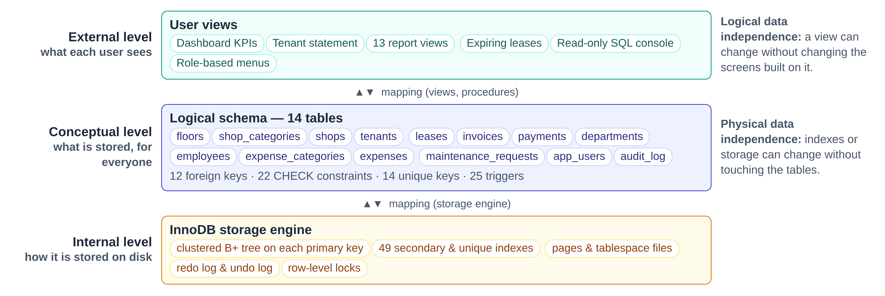

<b>Figure 1.</b> <i>The ANSI/SPARC three-schema architecture applied to the mall database</i>

Users never work with storage details. A manager looking at the *tenant balances* report sees an **external view**. The view is defined over the **conceptual schema** of 14 tables, and InnoDB decides the **internal** layout of pages and B+ trees. Because each level is mapped to the next, an index can be added (physical independence) or a report changed (logical independence) without rewriting the application.

> **Data models**
>
> The core model is **relational**. The audit log also stores *semi-structured* JSON documents (the old and new values of a changed row), and the monthly summaries are a simple form of *time-series* data. MySQL is classified as a centralised, multi-user, general-purpose relational DBMS.

---

## 3. Technical architecture

The application follows the classic **three-tier architecture**. Each tier has one job and talks only to its neighbour, so each one can be understood, tested and replaced on its own.

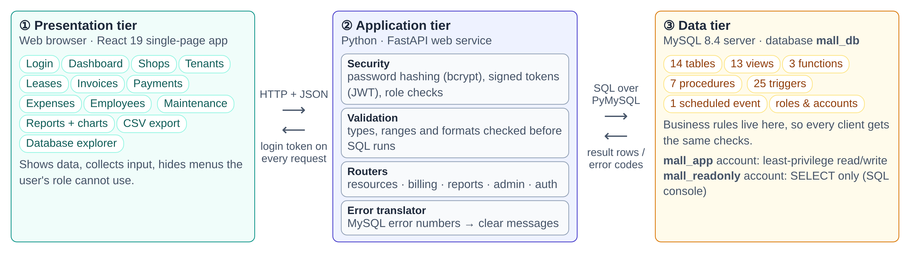

<b>Figure 2.</b> <i>Three-tier architecture of the Mall Management System</i>

### 3.1 Responsibilities of each tier

- **Presentation tier (React).** Shows forms, tables and charts in the browser. It holds no business rules except convenience checks, and it hides menus the user's role cannot use.
- **Application tier (FastAPI).** Checks who the user is (login token) and what they may do (role). It validates input, turns each request into SQL, and translates database errors into clear messages.
- **Data tier (MySQL).** The single source of truth. Constraints, triggers and procedures enforce the rules here, so even a mistake in the application cannot store invalid data.

Keeping the rules in the database is deliberate: any program that connects later, such as a mobile app or a script, gets the same protection.

### 3.2 Technology stack

| Layer | Technology |
|---|---|
| Database | MySQL 8.4 LTS (InnoDB engine) |
| DB driver | PyMySQL (similar to ODBC / JDBC) |
| Web service | Python 3, FastAPI, Pydantic |
| Security | bcrypt hashes, JWT, MySQL roles |
| User interface | React 19, Recharts, Vite |
| Testing | pytest, against a real database |
| Tooling | `manage.py` command-line helper |

### 3.3 Life of a request

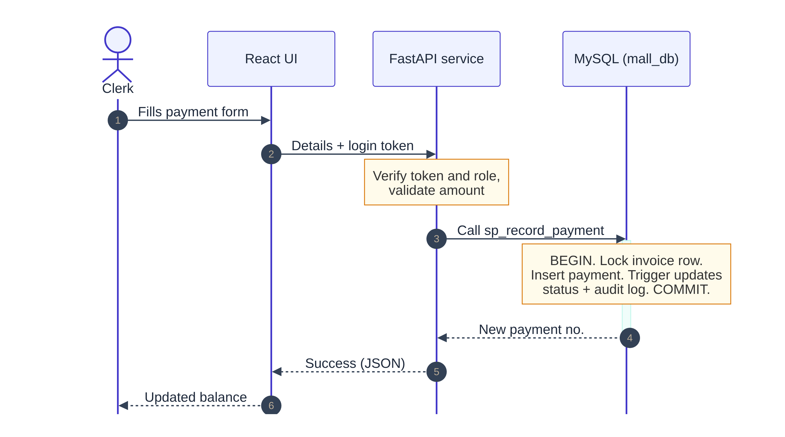

<b>Figure 3.</b> <i>Recording a rent payment, step by step (UML sequence diagram)</i>

Every screen follows the same pattern. The browser sends a small JSON message with the login token; the service checks it and runs one SQL statement or stored procedure; the database applies its rules inside a transaction and returns rows or an error number. Error 3819 (a CHECK failed) becomes a plain message naming the broken rule, and error 1451 becomes *“this record is still referenced by other records”*. This is how the front end is *interfaced* with the database (lab experiment 9).

---

## 4. Conceptual design: the ER model

The requirements were turned into an **Entity-Relationship (ER) model** before any table was created. Nouns in the requirements (*shop, tenant, lease, invoice …*) became **entities**. Verbs (*a tenant signs a lease*, *an invoice is settled by payments*) became **relationships**.

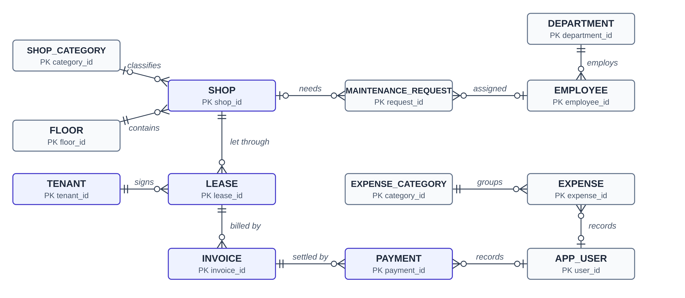

<b>Figure 4.</b> <i>ER diagram in crow's-foot notation (primary keys shown; audit_log stands alone and is written by triggers)</i>

### 4.1 Reading the diagram

- **Cardinality.** All relationships are one-to-many (1:N). One floor *contains* many shops; one invoice is *settled by* many partial payments.
- **Participation.** Two bars (‖) mean *exactly one*, so every lease must belong to a shop (total participation). A circle (o) means *optional*: a shop may have no category, and a ticket may be for a common area with no shop.
- **Resolving many-to-many.** Over the years a shop has many tenants, and a tenant may rent many shops. That M:N relationship becomes the entity **LEASE**, which carries its own attributes (dates, rent, deposit, tax rate).

### 4.2 Attribute types

| Type | Example |
|---|---|
| Key | `unit_code` of a shop (e.g. G-01), `invoice_no` |
| Simple / single-valued | `area_sqft`, `monthly_rent`, `phone` |
| Derived | invoice tax and total; tenant balance; occupancy % |
| Composite key | (lease, billing month) identifies one invoice |
| Multivalued | none: kept out by design (they would break 1NF) |

### 4.3 Integrity constraints and how violations are handled

| Constraint type | Rule in the mall database | On violation |
|---|---|---|
| Domain | Area > 0; rent > 0; tax rate 0–100; e-mail and phone must match a pattern | Statement rejected (error 3819) |
| Key / uniqueness | Unit codes unique; only one invoice per lease per month | Duplicate rejected (error 1062) |
| NOT NULL | Business name, lease dates and amounts are mandatory | Rejected (error 1048) |
| Entity integrity | Every table has a primary key that is never NULL | Guaranteed by the DBMS |
| Referential integrity | 12 foreign keys, e.g. a lease must point to an existing shop and tenant | RESTRICT: shop with leases cannot be deleted. SET NULL: deleting a shop detaches its tickets |
| Semantic (business) | One active lease per shop; no lease on a shop under maintenance; no expenses dated in the future | Trigger raises an error; transaction rolled back |

> **Extended ER: specialisation and weak entities**
>
> Application users form a **specialisation** of USER into *admin*, *manager* and *staff* (disjoint, total). It is mapped to a single table with a `role` discriminator column, because the subclasses have no attributes of their own. A PAYMENT behaves like a **weak entity** of INVOICE, since it has no meaning without its invoice. It still receives its own surrogate key, and the RESTRICT foreign key stops an invoice with payments from being deleted.

---

## 5. Relational design and normalisation

### 5.1 Mapping the ER model to relations

The textbook mapping algorithm was applied step by step:

- each **strong entity** became a table whose primary key is a surrogate `id` column;
- each **1:N relationship** became a **foreign key** on the *many* side (e.g. `shop_id` inside `leases`);
- the **M:N** relationship between shops and tenants became the table `leases`, with two foreign keys;
- **derived attributes** became *generated columns* (invoice tax and total) or *views* (tenant balance).

### 5.2 Functional dependencies

A functional dependency X → Y means that knowing X fixes Y. Some dependencies found in the mall data:

| Dependency | Meaning |
|---|---|
| shop_id → unit_code, floor_id, area_sqft | a shop's details depend on the shop |
| floor_id → name, level_number | a floor's name depends on the floor, not on the shop |
| (lease_id, billing_month) → invoice_id | a candidate key: one bill per lease per month |
| rent_amount, tax_rate → tax_amount, total_amount | derived, so computed by the database instead of typed |

Armstrong's axioms (reflexivity, augmentation, transitivity) give further dependencies. For example, shop_id → floor_id and floor_id → name give **shop_id → name** by transitivity. A dependency like that is a warning sign that the floor name belongs in a separate table.

### 5.3 Normalising the rent register

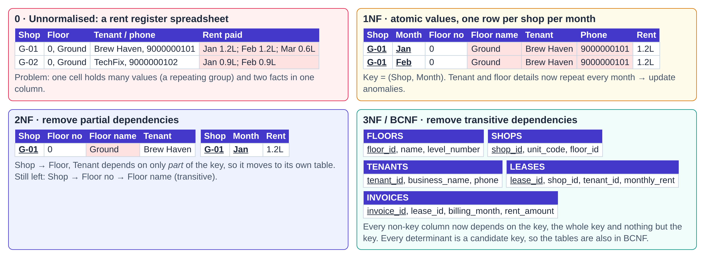

<b>Figure 5.</b> <i>From a paper rent register to normalised tables (red cells show the problem removed at each step)</i>

| Normal form | Rule (in simple words) | What it fixed here |
|---|---|---|
| 1NF | Every cell holds one atomic value; no repeating groups | One row per shop per month instead of a list of months in one cell |
| 2NF | No non-key column depends on only *part* of a composite key | Tenant and floor facts moved out of the monthly rows |
| 3NF | No non-key column depends on another non-key column | Floor name moved to `floors`, category name to `shop_categories` |
| BCNF | Every determinant is a candidate key | Holds for all 14 tables (unique codes are declared as keys) |
| 4NF / 5NF | No independent multi-valued facts; no lossy joins | No multivalued attributes are stored, so no extra splits are needed |

> **Design decision: history is not redundancy**
>
> An invoice copies the rent and tax rate from its lease at billing time. This looks like duplication, but it is a *snapshot*: if the rent goes up next year, old invoices must still show what was actually billed. In the same way, `shops.status` is a small piece of **controlled redundancy**. Triggers keep it in step with the leases, so the directory screen does not have to search the leases every time.

---

## 6. Physical design and query processing

### 6.1 File organisation and B+ tree indexes

InnoDB stores every table as an **ordered file**: a *clustered* B+ tree sorted by the primary key, with the rows themselves in the leaves. Every other index is a *secondary* B+ tree whose leaves hold the key plus the primary key of the row. Because B+ trees stay balanced, any row is found in a few page reads, whether the table holds 26 rows or 26 million.

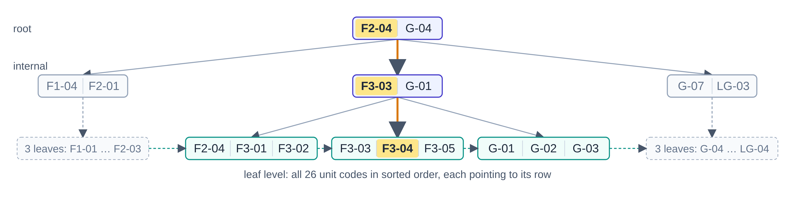

<b>Figure 6.</b> <i>B+ tree on shops.unit_code: searching for F3-04 visits root → internal node → leaf</i>

### 6.2 Does an index really help? An experiment

A test table was filled with 10,000 to 1,000,000 rows. The same *find one tenant's rows* query was timed with the index and with a forced full scan (median of repeated runs on this machine).

The scan time grows in step with the table size (O(n)), reaching **437 ms** at one million rows. The B+ tree lookup stays at about **0.2 to 0.5 ms** (O(log n)), roughly **850 times faster**. The query optimiser's own estimate agrees: 1 row examined with the index, about 995,000 without.

| Index kind | Example in mall_db |
|---|---|
| Clustered (primary) | `invoice_id` on invoices |
| Unique | (lease_id, billing_month): no double billing |
| Composite | (status, due_date): the overdue list |
| On a generated column | `active_shop_key`: one active lease per shop |

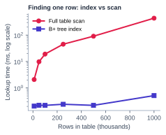

<b>Figure 7.</b> <i>Measured lookup time, index vs full scan (log scale)</i>

### 6.3 From SQL to an optimised query tree

When a manager asks for *tenants with unpaid invoices*, MySQL first translates the SQL into **relational algebra**. The same question can also be written in **tuple relational calculus**, which says *what* is wanted rather than *how* to get it:

π business_name, balance ( σ status='unpaid' (INVOICES) ⋈ LEASES ⋈ TENANTS ) { t.business_name | TENANTS(t) ∧ ∃l ∃i ( LEASES(l) ∧ INVOICES(i) ∧ l.tenant_id = t.tenant_id ∧ i.lease_id = l.lease_id ∧ i.status = 'unpaid' ) }

The optimiser rewrites the algebra as a **query tree** and improves it with **heuristic rules**:

- push selections (σ) down, as close to the tables as possible;
- replace a Cartesian product followed by a selection with a join (⋈);
- handle the most selective relation first, using an index where one exists.

The optimised tree reads **28** index entries instead of building **73,440** combinations.

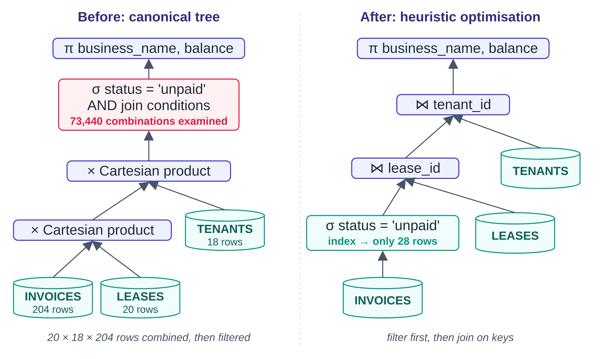

<b>Figure 8.</b> <i>Canonical vs heuristically optimised query tree</i>

---

## 7. Business workflow and automation

The flowchart follows a shop unit through its full business cycle. Orange boxes are steps the **database performs by itself** through triggers, procedures and a scheduled event. Nobody has to remember to do them.

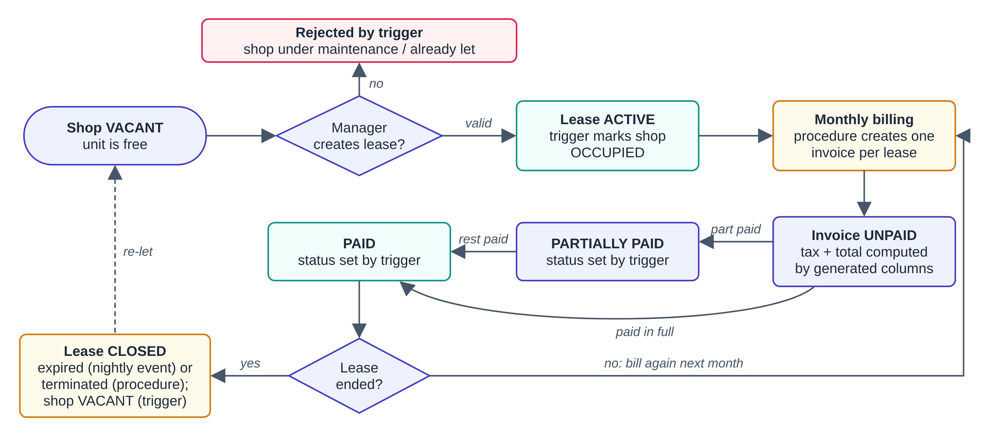

<b>Figure 9.</b> <i>End-to-end workflow: from a vacant shop to billing, payment and re-letting</i>

### 7.1 The life of an invoice

An invoice's status is never typed by a person. After every payment insert or reversal, a trigger calls the function `fn_invoice_status`, which compares the amount paid with the total. Invoices are **voided, never deleted**, and payments are **never edited**, only reversed by an administrator. The money trail therefore stays complete.

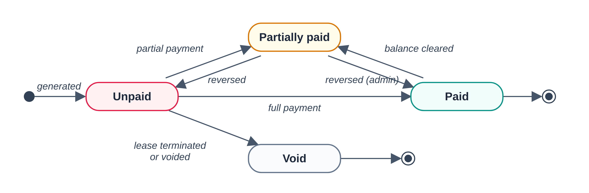

<b>Figure 10.</b> <i>Invoice state diagram (states are set by triggers)</i>

### 7.2 Monthly billing in one statement

The procedure `sp_generate_invoices` bills every active lease for a month with a single *set-based* INSERT … SELECT, not a loop. It picks the active leases, copies the rent and tax rate, and numbers the bills. The unique key on (lease, month) makes the job **idempotent**: running it twice cannot bill anyone twice.

Reports use the same set-based style. The tenant statement uses a **window function** to keep a running balance. The monthly summary uses a **recursive CTE** to list every month, including months with no activity.

### 7.3 Rules that live inside the database

| Object | Qty | Examples |
|---|---|---|
| BEFORE triggers | 13 | validate data: no lease on a shop under maintenance, no future-dated expense |
| AFTER triggers | 12 | sync shop status, update invoice status, write the audit trail |
| Procedures | 7 | record payment, terminate lease, expire leases, tenant statement, monthly summary |
| Functions | 3 | amount paid, balance due, invoice status |
| Event | 1 | runs every night and expires leases past their end date |
| Views | 13 | profit and loss, occupancy, expiring leases, payroll … |

---

## 8. Transactions, concurrency and recovery

A **transaction** is a group of operations that must succeed or fail as one unit. Recording a payment involves locking the invoice, inserting the payment, updating the invoice status and writing the audit log. If any step fails, none of them may remain.

| ACID property | Meaning | How the project guarantees it |
|---|---|---|
| Atomicity | All or nothing | Procedures open a transaction; an error handler rolls back and re-raises the error |
| Consistency | Valid state before and after | Constraints and triggers are checked inside the transaction |
| Isolation | Concurrent work does not interfere | REPEATABLE READ isolation plus explicit row locks |
| Durability | Committed means permanent | InnoDB writes the redo log to disk before confirming COMMIT |

### 8.1 Concurrency control with two-phase locking

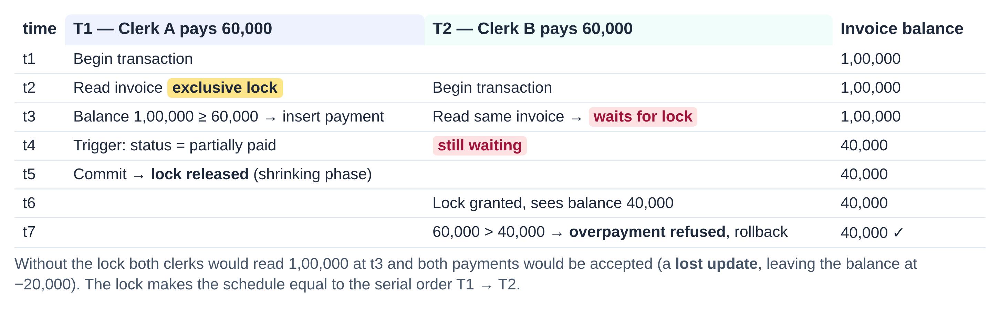

<b>Figure 11.</b> <i>Two clerks paying the same invoice at the same time: the lock prevents a lost update</i>

`sp_record_payment` reads the invoice with an **exclusive row lock**. Locks are only acquired while the transaction works (the *growing phase*) and are all released at COMMIT (the *shrinking phase*). This is **strict two-phase locking**, which guarantees a **conflict-serializable** schedule: the result is the same as if T1 had finished completely before T2 began. InnoDB uses **multiple-granularity locking**, with intention locks on the table and real locks on rows. If two transactions ever wait for each other (a **deadlock**), InnoDB finds the cycle in its wait-for graph and rolls one of them back so it can be retried.

### 8.2 Recovery and backup

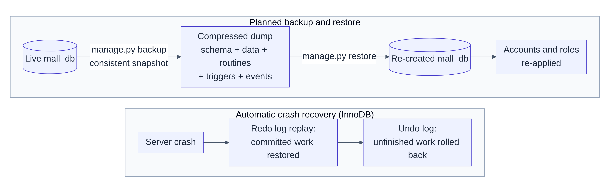

<b>Figure 12.</b> <i>Planned backup / restore and automatic crash recovery</i>

InnoDB uses **immediate update** with write-ahead logging. Changes may reach the data files before COMMIT, so after a crash it needs both operations: **REDO** replays committed work from the redo log, and **UNDO** removes unfinished work using the undo log. For planned protection, `manage.py backup` takes a consistent snapshot of the whole database without locking users out, and `restore` rebuilds it. A data-only backup can also be downloaded from the admin screen. Changes to the important tables (shops, tenants, leases, invoices, payments, employees) are copied to `audit_log` with the old and new values, the user and the time.

> **Security (DCL)**
>
> The web service connects as `mall_app`, a least-privilege account: it cannot delete invoices or change payments. The SQL console uses `mall_readonly`, which has SELECT only and cannot read password hashes. On top of this, the application roles admin / manager / staff decide which screens each person may use.

---

## 9. Results, testing and outlook

All reports are plain SQL views and procedures. The charts below were drawn directly from the sample database (26 shops, 20 leases, 204 invoices, 176 payments, 100 expenses).

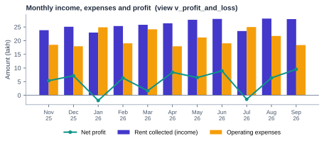

<b>Figure 13.</b> <i>Monthly profit and loss over the last eleven complete months</i>

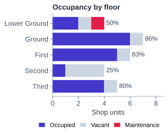 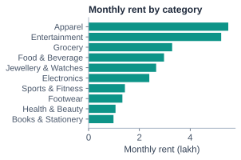 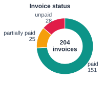

<b>Figure 14.</b> <i>Occupancy by floor</i> · <b>Figure 15.</b> <i>Rent by shop category</i> · <b>Figure 16.</b> <i>Invoice status</i>

### 9.1 Testing

13 automated integration tests run against a real MySQL database, and all 13 pass. They cover:

- login, roles and permission errors (403 for staff on admin tools);
- each constraint type: CHECK, unique, foreign key and trigger errors;
- the full lease → invoice → payment → termination cycle with balances;
- overpayment and voided invoices being rejected;
- reports, the read-only SQL console and backup download.

### 9.2 Outlook: distributed and NoSQL

For a **chain** of malls, the tables could be **horizontally fragmented** by mall, with each site holding its own shops and leases, and **replicated** to a read-only copy for head-office reports. Under the **CAP theorem**, rent and payments need consistency, so they stay ACID. The audit trail or a dashboard cache could use a **BASE** key-value or document store, where *eventually consistent* is good enough.

### 9.3 Conclusion

The project shows the syllabus working together in one system. The ER model and normalisation produced a clean BCNF schema. Constraints, triggers and procedures turned business rules into guarantees. Indexes and query trees make retrieval fast, and transactions with two-phase locking keep money correct under concurrent use. Logging and backups protect the data, and a web front end makes all of it usable. Possible next steps are online rent payment, cloud hosting of the database and replication for a multi-site setup.

Database Systems course project · Mall Management System
